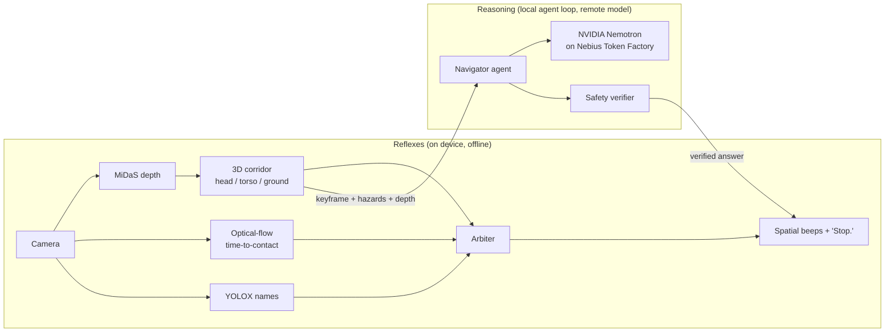

<div align="center">

# BatVision AI

### A safety co-pilot for blind and low-vision people.
**Reflexes on the device. Reasoning from NVIDIA Nemotron. Every answer verified before it is spoken.**


*Built for the Nebius x NVIDIA Global AI Hackathon by team ZeroLatency.*

</div>

> A white cane protects your shins. BatVision protects your forehead, spots the silent e-scooter, and asks
> NVIDIA Nemotron where the door handle is.

---

## Contents

1. [The 30-second pitch](#the-30-second-pitch)
2. [How we use NVIDIA Nemotron and Nebius Token Factory](#how-we-use-nvidia-nemotron-and-nebius-token-factory)
3. [Setup, step by step](#setup-step-by-step)
4. [Running it](#running-it)
5. [Things to say and try](#things-to-say-and-try)
6. [Tests and evals](#tests-and-evals)
7. [Configuration](#configuration)
8. [Project layout](#project-layout)
9. [Measured results and honest limits](#measured-results-and-honest-limits)
10. [Troubleshooting](#troubleshooting)
11. [What changed during the hackathon](#what-changed-during-the-hackathon)
12. [Safety notice](#safety-notice)
13. [License](#license)

---

## The 30-second pitch

Walking into a low branch teaches you something a cane never will: **what is above your waist and what is
fast and silent is invisible to a cane**. AI "describe my surroundings" apps help, but they are slow, need a
network, and can say *"the path is clear"* with total confidence when it is not.

So BatVision is built like a nervous system:

| | Hemisphere 1: **Reflexes** | Hemisphere 2: **Reasoning** |
|---|---|---|
| Runs | On the device, every frame | On request; only the model call leaves the machine |
| Needs internet | **No** | Yes, and it degrades gracefully without it |
| Does | Depth, a 3D walking corridor, time-to-contact, spatial beeps, "Stop." | "Where is the red water bottle?", "What does that sign say?" |
| Tech | OpenCV 5 DNN, MiDaS, YOLOX, optical flow | **NVIDIA Nemotron** on **Nebius Token Factory** |
| Trusted on safety? | **Yes** | **Never** |

The rule that makes it work: **the cloud model is never trusted on safety.** A deterministic `SafetyVerifier`
checks every model answer against the device's own depth sensing.

```text
Nemotron:   "The path ahead looks clear."
Edge depth: obstacle at 0.9 m, torso zone
Verifier:   VETO
Spoken:     "Stop. Obstacle directly ahead."
```



---

## How we use NVIDIA Nemotron and Nebius Token Factory

### NVIDIA Nemotron

- **Model:** `nvidia/Nemotron-3.5-Super-VL`, an NVIDIA open model, used **out of the box** (no fine-tuning).
- **Role:** the agent brain. It looks at a camera frame, decides which OpenCV tool to call, reads the result,
  and returns a structured answer (speech, target label, bounding box, confidence).
- **Tool-calling agent:** it can call `assess_image_quality`, `find_text_regions`, `zoom_region`,
  `analyze_region_color` and `measure_region_depth`, then `final_answer`. Each result decides its next step
  (blurry photo? ask for a better view. Small text? zoom and re-read). Every call is traced.
- **What we learned about it:** it is a *reasoning* model. With thinking on, about half of our agent answers
  ran out of tokens and came back empty. Passing `chat_template_kwargs: {"enable_thinking": false}` fixed it:
  4 of 4 forced tool calls worked and those calls dropped from about 3.5 s to about 1.2 s
  (`NebiusAgent` in [src/batvision/cloud/vlm.py](src/batvision/cloud/vlm.py)).
- **Model comparison we ran** (same photo, same tool setup, indicative only): Nemotron-3.5-Super-VL about 2.0 s
  median with working image input, tool calls and structured output; a smaller Nemotron Nano 12B v2 was about
  3x faster but produced no tool call or valid JSON in 3 of 3 runs; DeepSeek V4.1 Flash was slower (5 to 9 s).

### Nebius Token Factory (where it sped us up)

| What Token Factory gave us | Why it mattered |
|---|---|
| **OpenAI-compatible API** | Integration was a base URL, a key and a model ID with the standard `openai` client. No custom SDK. |
| **Managed hosting** | No GPU instances, containers or servers to run. A small team spent its time on the on-device pipeline and the safety verifier instead. |
| **Images + tool calling on one endpoint** | Made an agent that calls OpenCV tools on the photo possible without stitching services together. |
| **Models endpoint** | Used to confirm exact model IDs and find that only one NVIDIA vision model was listed. |
| **One-variable model switching** | `NEBIUS_MODEL_ID` let us compare Nemotron against other models on identical code in minutes. |

**Other Nebius services:** none. We use Token Factory only, called directly from the local agent loop. We did
not use dedicated GPU instances, Serverless Endpoints/Jobs or AI Cloud, because our request volume did not
need them. A Serverless Endpoint is the natural next step for keeping the API key off wearable devices.

The model call is the *only* thing that leaves the machine, and BatVision keeps protecting the user if it
fails (reflexes only).

---

## Setup, step by step

You need: **Python 3.10+**, **Git**, a **webcam** (or a video file), and **stereo headphones** (beeps pan
left/right). A Nebius key is optional; without it you still get the full reflex system.

### 1. Clone

```bash
git clone https://github.com/yadavmanan/batvision.git
cd batvision
```

### 2. Create a virtual environment

macOS / Linux:

```bash
python3 -m venv .venv
source .venv/bin/activate
```

Windows PowerShell:

```powershell
py -m venv .venv
.\.venv\Scripts\Activate.ps1
```

### 3. Install

```bash
pip install -U pip
pip install -r requirements-dev.txt
pip install -e .
```

Linux only: `sudo apt install libportaudio2 espeak-ng` (audio and offline speech). On a board with no display,
swap `opencv-python` for `opencv-python-headless` and run with `--headless`.

### 4. Download the vision models (about 100 MB)

```bash
python scripts/download_models.py
```

This fetches MiDaS v2.1 small (depth) and YOLOX (object names) into `models/`. They are git-ignored.
Optional extras: `--all` adds Depth-Anything-V2 and the Vosk offline speech model.

### 5. Add your Nebius Token Factory key (optional)

```bash
cp .env.example .env          # Windows: copy .env.example .env
```

Open `.env` and set `NEBIUS_API_KEY=...`. The file is git-ignored; never commit it. Create the key in your
Nebius Token Factory account.

### 6. Check everything works

```bash
pytest                                  # offline tests; no camera, models or key needed
python scripts/smoke_test_model.py      # optional: one live Nemotron round trip (costs a little)
```

---

## Running it

**Reflexes only** (no key, no network, still protects you):

```bash
python -m batvision.edge.app --set cloud.enabled=false
```

**With Nemotron** (key in `.env`):

```bash
python -m batvision.edge.app
```

PowerShell, explicit:

```powershell
$env:VLM_BACKEND = "nebius"
$env:NEBIUS_THINKING = "false"
python -m batvision.edge.app --source 0 --set cloud.enabled=true --set voice.backend=keyboard
```

**Mock model** (full pipeline, no key, no network):

```bash
VLM_BACKEND=mock python -m batvision.edge.app       # PowerShell: $env:VLM_BACKEND = "mock"
```

**Other handy flags**

```bash
python -m batvision.edge.app --source "path/to/walk.mp4"          # a recorded video (loops)
python -m batvision.edge.app --source "http://PHONE_IP:8080/video" # phone as an IP camera
python -m batvision.edge.app --headless --frames 300               # no windows; prints latency at the end
python -m batvision.edge.app --set depth.input_size=192 --set detector.hz=1
```

In the debug window: `1`-`4` ask preset questions, `v` push-to-talk, `c` recalibrate the floor, `q` / `Esc`
quit. You can also type questions in the terminal.

**First run tip:** hold the camera at chest height, walk slowly toward a chair, and listen. Beeps speed up as
you get closer; at about 1.2 m you hear "Stop."

---

## Things to say and try

- "Where is the red water bottle?"
- "What does the sign in front of me say?"
- "Describe what is around me."
- "Is the path clear?" (try it with an obstacle in front; watch the verifier overrule the model)
- "Repeat", "quiet mode", "indoor mode", "speak faster", "add note: bus stop is on the left"

---

## Tests and evals

```bash
pytest                          # fast offline suite
pytest -m latency -s            # edge latency benchmark on the real models
pytest -m live                  # hits the live model on Token Factory (costs money)
python eval/eval_agent_tools.py --backend nebius     # agent tool-use scenarios
python eval/eval_detector_coco.py                    # detector mAP (needs the COCO subset script)
python eval/eval_vizwiz_vlm.py --limit 100           # VLM accuracy on VizWiz (not yet reported)
```

---

## Configuration

Everything lives in [config/edge_config.yaml](config/edge_config.yaml); override any key from the command line
with `--set section.key=value`. The ones people touch first:

| Key | Meaning |
|---|---|
| `camera.source` | Webcam index, video file, or stream URL |
| `camera.hfov_deg` | Horizontal field of view. Measure yours; geometry depends on it |
| `mount.height_m`, `mount.pitch_deg` | Where the camera sits on the body (floor calibration) |
| `cloud.enabled` | `false` = reflexes only |
| `voice.backend` | `keyboard`, `vosk` (offline voice) or `none` |
| `depth.input_size` | 128 hits the latency target on a laptop CPU; 192-256 for faster hardware |

Environment variables (see [.env.example](.env.example)): `NEBIUS_API_KEY`, `NEBIUS_MODEL_ID`,
`NEBIUS_BASE_URL`, `VLM_BACKEND` (`nebius` or `mock`), `NEBIUS_THINKING`.

---

## Project layout

```text
batvision/
├── config/edge_config.yaml      # all runtime settings
├── src/batvision/
│   ├── edge/                    # reflexes: depth, hazards, flow, arbiter, audio, app.py
│   ├── cloud/                   # agent loop, Nemotron client (vlm.py), OpenCV tools, memory
│   └── common/                  # schemas, prompts, spatial maths, SafetyVerifier
├── scripts/                     # download_models, smoke_test_model, show_agent_tools, data prep
├── eval/                        # detector, agent-tool and VizWiz evaluations
├── tests/                       # offline unit + integration tests
├── training/                    # optional LoRA fine-tuning experiment (not used in the demo)
├── .env.example                 # copy to .env and add your key
└── LICENSE                      # MIT
```

---

## Measured results and honest limits

| Metric | Result | Reproduce |
|---|---|---|
| Edge reflex loop (depth + corridor + flow) | p50 **47 ms**, p95 53 ms on a laptop CPU (OpenCV 5.0.0, 128 px) | `pytest -m latency -s` |
| Time-to-contact | 1.13 s true vs 1.18 s detected; slow 4 s approaches correctly ignored | `tests/test_optical_flow.py` |
| Floor calibration | Under 5% median error on synthetic floor pixels | `tests/test_geometry_hazards.py` |
| Detector (YOLOX-S) | mAP@[.5:.95] 0.349, mAP@.5 0.467 on a 60-image COCO subset | `eval/eval_detector_coco.py` |
| Nemotron latency | **Misses our 1.5 s target:** median about 2.0 s, worst 3.4 s over 8 live requests (thinking off) | `scripts/smoke_test_model.py` |
| Cloud VLM accuracy on VizWiz | Not yet measured | `eval/eval_vizwiz_vlm.py` |

Known limits, said plainly:

- Model latency misses the target. That is exactly why safety never waits for it.
- Calibration is validated mostly on synthetic scenes and a few real walks.
- Nemotron sometimes answers in plain text instead of calling the final-answer tool, and has read text from an
  image our quality tool flagged as unusable. The verifier and quality tool limit the damage.
- Not clinically validated. Not a medical device.

---

## Troubleshooting

| Symptom | Fix |
|---|---|
| Log says "reflexes-only" or model never answers | Check `.env` has `NEBIUS_API_KEY`; run `python scripts/smoke_test_model.py` |
| `cannot open camera source` | Wrong index (try `--source 1`), camera in use, or OS camera permission denied |
| No sound / no speech | Install headphones as the default output; on Linux install `libportaudio2` and `espeak-ng` |
| Warnings feel too early or too late | Fix `mount.height_m` / `mount.pitch_deg`, then press `c` to recalibrate |
| Empty or truncated model answers | Keep `NEBIUS_THINKING=false` (the default) |
| 401 / 404 from the model | Bad key or model ID. These do not flip the app offline, by design |
| Slow frames on a weak CPU | Lower `depth.input_size`, `detector.hz`, or run `--headless` |

---

## What changed during the hackathon

BatVision began as an earlier project (the OpenCV AI Competition 2026 build, with its cloud tier on AWS). For
this hackathon we:

- Moved the reasoning model to **NVIDIA Nemotron-3.5-Super-VL on Nebius Token Factory** and removed the
  server/AWS deployment; the agent loop now runs locally and calls Token Factory directly.
- Built the OpenAI-compatible `NebiusAgent` backend, and found and fixed the reasoning-token problem.
- Added the tool-calling agent with five OpenCV tools and a per-call trace.
- Added the second, on-device safety re-verification step before speech, plus the offline `mock` backend.

---

## Safety notice

BatVision AI is an assistive prototype. It is **not** a medical device, is not clinically validated, and is not
a replacement for a white cane, a guide dog or trained assistance. The on-device reflex layer is the
safety-critical part; the cloud reasoning layer is an aid only.

---

## License

Released under the [MIT License](LICENSE) (an OSI-approved open source license). Copyright (c) 2026 Manan Yadav.

Third-party models keep their own licenses: MiDaS (MIT), YOLOX via OpenCV Zoo (Apache-2.0), Vosk (Apache-2.0),
and NVIDIA Nemotron on Nebius Token Factory under NVIDIA's and Nebius's terms.

Team **ZeroLatency**: Manan Yadav, Nitin Kumar Soni, Nida.
